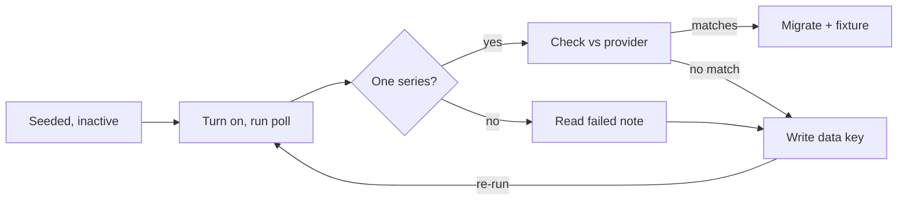

# Feature Spec — ABS Adapter & AU Indicator Activation

**Status:** Draft · **Author:** Chris Pollard · **Last updated:** 2026-10-17
**Companion to:** [`adapter-contract.md`](./adapter-contract.md), [`activating-an-indicator.md`](./activating-an-indicator.md)

## Overview

The ABS adapter already exists; what is missing is a verified request and the indicators to point it at. This spec turns on AU CPI and AU business confidence, hardens the ABS request against the current API, and adds six Australian series so the AU side mirrors what the platform tracks for the US.

Today only two Australian series are live (RBA cash rate and broad money) against six US ones. `apps/agents/src/lib/indicators/adapters/abs.ts`, `oecd.ts` and the shared `sdmx.ts` parser were built in June 2026 without network access, so their tests run on synthesised fixtures and both rows were left `is_active = false`. The existing runbook, [`activating-an-indicator.md`](./activating-an-indicator.md), predates the ABS move to a monthly CPI and now points at the wrong series.

**Delivers:**

- A request hardening pass on `sdmx.ts` (User-Agent, pinned dataflow versions, corrected runbook)
- AU CPI and AU Bus. Confidence live, with recorded fixtures replacing the synthesised ones
- Six new AU series: trimmed mean CPI, unemployment rate, wage price index, credit growth, commodity prices, 10-year government bond yield
- A derived AU–US 10-year spread, computed in a view
- Two new categories (`labour`, `credit`) carried through the findings engine and the indicator cards

**Not in scope:** new providers, ALFRED vintages, Australian bitcoin ETF data (separate spec), housing series (CoreLogic is paywalled; ABS lending indicators are a follow-up).

## Current state

Both parked AU rows fail for reasons the code already anticipates, plus two the code does not. Audit run against Supabase `zqtudpzojsmjemqxaaxb` and `main` on 17 October 2026.

| Indicator | Provider | `provider_table_ref` | Active | Observations | Blocker |
| --- | --- | --- | --- | --- | --- |
| RBA Cash Rate | rba | `F1:FIRMMCRTD` | yes | 39 | none |
| AU Broad Money | rba | `D3` (default column `DMABMS`) | yes | 36 | none |
| AU CPI | abs | `CPI` | no | 0 | No data key, so ABS returns every CPI series and the parser refuses. Seed targets the old quarterly series. |
| AU Bus. Confidence | oecd | `DSD_STES@DF_CLI / AUS.M.BCICP...AA` | no | 0 | Ref names no agency, so the adapter refuses before fetching. |

**What the code already handles.** The adapter registry wires `abs` and `oecd`. The provider check constraint allows both. `parseDataflowRef` reads `{dataflow}/{dataKey}`. The parser refuses multi-series answers and quotes 400 characters of the body into `agent_activity`, so a first failing run is diagnostic rather than silent.

**What the code does not handle (found in this audit):**

1. **No User-Agent on SDMX requests.** `fetchSdmx` sends only an `Accept` header. ABS documents that requests without a User-Agent can get a 403 or "Missing Authentication Token". The RBA, Stooq and Gold API adapters already send `BTS-platform/1.0 (economic-indicators)`; SDMX does not.
2. **The CPI the seed describes no longer exists as headline.** On 26 November 2025 ABS moved `CPI` from version 1.1.0 to 2.0.0, switched it to monthly, rebased it to September 2025 = 100, and renamed the region code "Weighted average of eight capital cities" to "Australia". The quarterly series returned in April 2026 as a separate dataflow, `CPI_Q`.
3. **The runbook's checks are now wrong.** It expects a quarterly key (`1.10001.10.50.Q`), periods like `2026-01-01, 2026-04-01`, and values "around 130–145". A correct monthly series rebased to 100 would fail all three checks.
4. **Unpinned dataflow versions can silently rewrite history.** A bare `CPI` resolves to the latest version. The next ABS rebase would arrive as a revision of every stored period, not as an error.

The `?format=jsondata` query parameter `abs.ts` adds is not in the current API guide, which documents format only through the `Accept` header. The adapter already sends that header, so the parameter is likely ignored, but it should be confirmed on the first live run.

## ABS Data API: what the docs say now

The adapter's host and path are correct; its request headers and the CPI target are not. Checked against the ABS Data API user guide pages listed in Sources.

| Topic | Current ABS behaviour | Adapter today | Change |
| --- | --- | --- | --- |
| Base URL | `https://data.api.abs.gov.au/rest/data/{flow}/{key}`, moved from `api.data.abs.gov.au/data/` on 29 November 2024 | Matches | none |
| API key | Removed 29 November 2024; no key needed | None sent | none |
| Dataflow id | `{agency},{id},{version}`; agency and version optional, version defaults to latest | Bare id (`CPI`) | Pin version in the ref |
| Removed version | Returns 404 | n/a | Wanted: a rebase fails loudly |
| Data key | Dimension codes in DSD order, dot-separated; empty = wildcard; `+` = OR | Read from ref | none |
| JSON format | `Accept: application/vnd.sdmx.data+json`; no format parameter documented | Header sent, plus `?format=jsondata` | Confirm param is harmless or drop it |
| User-Agent | Missing UA can return 403 or "Missing Authentication Token" | Not sent | Add |
| Timeout | Server times out at 30 s (504); responses over 10 MB can 504/500 | Client timeout 20 s | none for keyed queries |
| Missing JSON points | Documented fix: `x-range: values=0-n` header, or `dimensionAtObservation=AllDimensions` | Neither | Verify on first run; parser already reads the flat shape |
| Rate limits | Not documented | n/a | Daily poll is well inside any sane limit |

**CPI dataflows after the November 2025 transition:**

- `CPI` (version 2.0.0) is the complete Monthly CPI, Australia's headline inflation measure since the October 2025 reference month. Back series starts April 2024. Index base is September 2025 = 100.
- `CPI_Q` carries the quarterly series, reinstated April 2026 and derived as the average of three monthly prints. It holds history back to 1948.
- `CPI_M` (the old Monthly CPI Indicator) is discontinued. Do not target it.
- Codelists changed: `CL_CPI_INDEX` 1.0.0, `CL_CPI_MEASURES` 1.1.0, `CL_CPI_REGION` 1.1.0 (code for "Australia" to be read from the live structure).

The monthly back series is 30 months long at the time of writing. That is enough for the 18-period first backfill and for year-on-year in `v_indicator_latest`. A long-run chart would need `CPI_Q` stitched underneath; that is an open question, not part of this build.

**Release timing.** Monthly CPI is released about four weeks after the reference month, on the last Wednesday at 11:30 am AEDT. The daily 08:00 poll picks it up the next morning, which sets `released_at` one day late under the fetch-date fallback. Acceptable for v1, same as every other provider.

## Adapter changes

The contract in [`adapter-contract.md`](./adapter-contract.md) does not change. `ProviderAdapter.fetchLatest` stays a pure fetch-and-parse with a typed result and no database access. Three small edits make the requests match the current API.

**1. Send a User-Agent from `fetchSdmx`.** Shared by ABS and OECD, so both get it.

```ts
// apps/agents/src/lib/indicators/adapters/sdmx.ts
res = await fetch(url, {
  headers: {
    Accept: 'application/vnd.sdmx.data+json,application/json',
    'User-Agent': 'BTS-platform/1.0 (economic-indicators)',
  },
  signal: AbortSignal.timeout(20_000),
});
```

Promote the UA string to a shared constant in `lib/indicators/http.ts` while here; four adapters now repeat it.

**2. Map a 403 to a named error.** A missing-UA rejection currently surfaces as `transport` with "ABS HTTP 403". Give it its own message so the `agent_activity` row says what to check:

```ts
if (res.status === 403) {
  return { ok: false, error: { kind: 'transport', status: 403,
    message: `${provider} HTTP 403 for ${url.pathname}: provider refused the request (check User-Agent / egress)` } };
}
```

**3. Decide `?format=jsondata` on the first live run.** Leave it in for that run. If the response is valid SDMX-JSON, remove it anyway so the request matches the documented interface. If the response is an error, removing it is the fix.

**Pinned versions need no code change.** `parseDataflowRef` splits on the first slash and passes the left side into the URL path verbatim, and ABS accepts `ABS,CPI,2.0.0` in that position. So a ref of `ABS,CPI,2.0.0/<key>` works today. Add one test asserting the comma form survives `parseDataflowRef` and lands unencoded in the path.

**Fixtures.** After each first successful run, save the response body as `__fixtures__/sdmx-abs-<series>.json`, replace the synthesised `sdmx-abs-cpi.json`, and move the file from the synthesised list to the recorded list in `__fixtures__/README.md`. The sandbox cannot reach `data.api.abs.gov.au` (confirmed again 17 October 2026), so full payloads come from a browser request to the same URL; the poll stores only per-observation slices in `raw`.

## Indicator set

Eight AU rows end up active: two corrected, six new. Four need the ABS adapter, three ride on the RBA adapter that already works, one needs OECD. Every ref marked *confirm* is a best guess written without network access; the activation loop below is how it gets confirmed.

| Short label | Series | Provider | `provider_table_ref` | Granularity | Unit | Category | Phase |
| --- | --- | --- | --- | --- | --- | --- | --- |
| AU CPI | Monthly CPI, All groups, Australia, index, original | abs | `ABS,CPI,2.0.0/<key>` *confirm key* | monthly | index | inflation | 1 |
| AU Bus. Confidence | OECD Business Confidence Index, Australia | oecd | `OECD.SDD.STES,DSD_STES@DF_CLI,/AUS.M.BCICP...AA` *confirm agency* | monthly | index | activity | 1 |
| AU Trimmed Mean | Monthly CPI trimmed mean, annual % change, SA | abs | `ABS,CPI,2.0.0/<key>` *confirm key* | monthly | percent | inflation | 2 |
| AU Unemployment | Labour Force, unemployment rate, persons, SA | abs | `ABS,LF,<ver>/<key>` *confirm flow, version, key* | monthly | percent | labour | 2 |
| AU WPI | Wage Price Index, total hourly rates excl. bonuses, all sectors | abs | `ABS,WPI,<ver>/<key>` *confirm flow, version, key* | quarterly | index | labour | 2 |
| AU Credit | Total credit, level, SA | rba | `D2:<series id>` *confirm column* | monthly | aud_billion | credit | 3 |
| AU Commodity Prices | RBA Index of Commodity Prices, AUD | rba | `I2:<series id>` *confirm column* | monthly | index | commodity | 3 |
| AU 10Y | Australian Government 10-year bond yield | rba | `F2:FCMYGBAG10D` *confirm column* | daily | percent | bond_yield | 3 |

**Why these.** CPI and trimmed mean are what the RBA targets; the trimmed mean is the number its statements lead with. Unemployment and wages are the other half of the RBA's mandate. Credit, commodities and the 10-year are the money, income and rates legs that mirror the US set (M2, Philly Fed, 10Y).

**Store levels, derive growth.** `AU Credit` stores the D2 level, not D1's pre-computed growth rate. `v_indicator_latest` already returns `yoy_pct_change`, so 12-month credit growth comes free and stays consistent with how M2 is handled. Trimmed mean is the one exception: ABS publishes it as a percentage change, not an index, so the stored value is the annual rate.

**The AU–US 10-year spread is computed, not stored.** A view `v_au_us_10y_spread` joins AU 10Y and US 10Y on `period_date` and returns `au - us` in percentage points. No registry row, no observations, per the computed-over-stored principle.

**RBA daily tables need one adapter change.** `rba.ts` collapses every table to one value per month (last business day). For AU 10Y to pair with the daily US 10Y, the adapter must honour `granularity = 'daily'` and keep each row with its own date. The cash rate row stays monthly and keeps today's behaviour. Add a `rba-f2.csv` fixture (recorded from a browser) and a test that a daily row returns one observation per business day.

**AU CPI unit check after activation.** Expect values near 100 (base September 2025 = 100) and periods on the first of each month from April 2024. The old runbook's "130–145" check would reject a correct series.

## Data model and seed SQL

No new tables. Three migrations: widen two check constraints, seed six inactive rows, add one view. Activations then follow the runbook, one migration per indicator once its live run is verified. Each migration gets a dated entry in `docs/schema-changes.md`, and filenames use the current UTC time so they cannot collide.

**Migration A: categories.** `labour` and `credit` join the eight existing categories.

```sql
ALTER TABLE economic_indicators DROP CONSTRAINT IF EXISTS economic_indicators_category_check;
ALTER TABLE economic_indicators ADD CONSTRAINT economic_indicators_category_check
  CHECK (category IN ('policy_rate','money_supply','inflation','activity',
                      'fx','commodity','equity','bond_yield','labour','credit'));

INSERT INTO finding_metric_config (metric_group, thesis_weight, vol_class, allowed_vocab) VALUES
  ('labour', 0.90, 'low', ARRAY['labour market','employment','unemployment','wages','wage growth']::text[]),
  ('credit', 1.20, 'low', ARRAY['credit','credit growth','lending','leverage','expansion','contraction']::text[])
ON CONFLICT (metric_group) DO NOTHING;

-- commodity vocab was written for gold only
UPDATE finding_metric_config
SET allowed_vocab = allowed_vocab || ARRAY['commodity prices','export prices','terms of trade']::text[]
WHERE metric_group = 'commodity';
```

Thesis weights are proposals. Credit sits just under money supply (1.40) because it is the private-sector half of the same liquidity story; labour sits below inflation (1.10) because the thesis runs through money, not jobs.

**Migration B: seed the six new rows, inactive.** Same pattern as the June seed: rows exist with best-guess refs and `is_active = false`, so turning one on is a deliberate, verified step.

```sql
INSERT INTO economic_indicators
  (name, short_label, region, category, provider, provider_table_ref,
   unit, decimals, period_granularity, poll_frequency, is_active, notes)
VALUES
  ('AU Trimmed Mean CPI (annual %)', 'AU Trimmed Mean', 'au', 'inflation', 'abs',
   'ABS,CPI,2.0.0', 'percent', 1, 'monthly', 'daily', false,
   'Monthly CPI analytical series, trimmed mean, % change from corresponding month of previous year, SA. Data key to be written from the first live response. Stored as a rate: ABS does not publish a trimmed-mean index.'),
  ('AU Unemployment Rate', 'AU Unemployment', 'au', 'labour', 'abs',
   'ABS,LF', 'percent', 1, 'monthly', 'daily', false,
   'Labour Force, Australia. Unemployment rate, persons, seasonally adjusted. Dataflow id and version unconfirmed; check explore.abs.gov.au.'),
  ('AU Wage Price Index', 'AU WPI', 'au', 'labour', 'abs',
   'ABS,WPI', 'index', 1, 'quarterly', 'weekly', false,
   'Total hourly rates of pay excluding bonuses, all sectors, Australia, original. Dataflow id and version unconfirmed.'),
  ('AU Total Credit', 'AU Credit', 'au', 'credit', 'rba',
   'D2', 'aud_billion', 1, 'monthly', 'weekly', false,
   'RBA D2 Lending and credit aggregates, total credit, SA level. Column Series ID to confirm against the live CSV. Growth comes from v_indicator_latest.yoy_pct_change.'),
  ('RBA Index of Commodity Prices (AUD)', 'AU Commodity Prices', 'au', 'commodity', 'rba',
   'I2', 'index', 1, 'monthly', 'weekly', false,
   'RBA I2, all items, AUD terms. Column Series ID to confirm against the live CSV.'),
  ('AU 10Y Government Bond Yield', 'AU 10Y', 'au', 'bond_yield', 'rba',
   'F2:FCMYGBAG10D', 'percent', 2, 'daily', 'daily', false,
   'RBA F2 Capital market yields, government bonds, daily. Needs rba.ts daily granularity support before activation.');
```

The ABS refs deliberately carry no data key yet. The adapter sends `all`, the parser refuses the multi-series answer, and the failure lists the series keys. That is the same diagnostic run the runbook already relies on.

**Poll daily for monthly ABS releases.** `weekly` means Mondays only (`isDue` in `runIndicatorPoll.ts`). Monthly CPI lands on the last Wednesday of the month, so a weekly row would sit five days stale behind a market-moving print. CPI, trimmed mean and unemployment poll `daily`; the AU CPI activation migration sets `poll_frequency = 'daily'` too. A daily request against a keyed SDMX query costs nothing.

**Migration C: the spread view.**

```sql
CREATE OR REPLACE VIEW v_au_us_10y_spread
WITH (security_invoker = true) AS
SELECT au.period_date,
       au.value            AS au_10y,
       us.value            AS us_10y,
       au.value - us.value AS spread_pp
FROM indicator_observations au
JOIN economic_indicators eau ON eau.id = au.indicator_id AND eau.short_label = 'AU 10Y'
JOIN indicator_observations us ON us.period_date = au.period_date AND us.is_current
JOIN economic_indicators eus ON eus.id = us.indicator_id AND eus.short_label = 'US 10Y'
WHERE au.is_current
ORDER BY au.period_date DESC;
```

Days where only one market traded (Australian or US public holidays) drop out of the inner join. That is correct: a spread needs both legs on the same day.

## Findings engine and UI

Activated rows flow through to findings, the market report and both indicator pages with no new wiring; only labels and vocabulary need adding.

**Findings engine.** `lib/findings/config.ts` loads every active macro row and groups it by `category`. A category missing from `finding_metric_config` falls back to weight 1.0 and `low` volatility, so nothing crashes, but the narrator gets an empty vocabulary list and the phrase linter would reject any sentence about it. Migration A adds `labour` and `credit` and widens `commodity` beyond gold. The quiet-day path is unaffected: eight more series means more candidates, not a lower materiality floor.

**Market report.** `runMarketReport.ts` reads `v_indicator_latest`, so active AU rows appear in the next report automatically. The narrator still only sees finding rows, never raw series (deterministic before LLM).

**Indicator cards** (`apps/web/lib/indicators/format.ts`):

```ts
const CATEGORY_LABELS: Record<string, string> = {
  // ...existing eight
  labour: 'Labour market',
  credit: 'Credit',
};
```

The units these rows use (`index`, `percent`, `aud_billion`) already have labels. Delta colouring stays neutral: a rising unemployment rate or falling credit gets no red or green, and gold remains the freshness marker only. Per `CLAUDE.md`, invoke the `bts-design` skill and check mobile widths before touching the cards.

**Minute `/indicators`.** Subscribers see a row once it is active, as the runbook already notes. Nothing here is advice or a conclusion, so the publish gate does not change; each card states the series, the period and the provider.

**Spread view.** `v_au_us_10y_spread` gets no card in this build. It is there for the findings engine and for a later rates card; adding a card is a one-session follow-up once AU 10Y has a month of daily data.

## Build sequence and tests

Three sessions, each ending with something live. Every activation follows the same loop: turn on, run the poll, read the failure, write the key, verify against the provider.



The first poll is expected to fail: its `failed` note lists the series keys the key is written from. A figure that does not match the provider's release page goes back to writing the key.

1. **Session 1: harden and activate AU CPI.**
    - `sdmx.ts`: User-Agent, 403 message, shared UA constant.
    - Test: `parseDataflowRef('ABS,CPI,2.0.0/1.2.3')` returns the comma form intact; the built URL path contains it unencoded.
    - Rewrite the CPI parts of `activating-an-indicator.md`: monthly key, `ABS,CPI,2.0.0` ref, values near 100, first-of-month periods from April 2024, Accept header instead of `?format=jsondata` in the browser example.
    - Run the loop for AU CPI. Activation migration sets the verified key, `period_granularity = 'monthly'`, `poll_frequency = 'daily'`, `is_active = true`.
    - Record `__fixtures__/sdmx-abs-cpi.json`; update `sdmx.test.ts` expected values; mark it recorded in the fixtures README.
2. **Session 2: ABS and OECD expansion.**
    - Migrations A and B.
    - Run the loop for AU Bus. Confidence, AU Trimmed Mean, AU Unemployment, AU WPI, one at a time.
    - Record one fixture per dataflow (`CPI` is already done; add `LF`, `WPI`, and the OECD v2 payload, replacing `sdmx-oecd-v2-flat.json`).
    - `format.ts` category labels.
3. **Session 3: RBA rows and the spread.**
    - `rba.ts` daily granularity; `rba-f2.csv` fixture; test one observation per business day for a daily row and unchanged month-end collapse for the cash rate.
    - Run the loop for AU Credit, AU Commodity Prices, AU 10Y (column matcher confirmed against each live CSV).
    - Migration C (`v_au_us_10y_spread`).

**Definition of done, per indicator.** First-of-period dates; values of the right magnitude and unit; roughly 18 backfilled periods; the newest figure matches the provider's own release page. The last check is the only one that catches a plausible wrong series, so it is not optional.

**Suite to keep green.** `pnpm turbo build --filter=@platform/agents` dependencies first, then the agents tests and typecheck. The migration timestamp-collision test covers the new files.

## Open questions

- [ ] **CPI headline on the card.** AU CPI rebased to 100 reads oddly as a level. Show `yoy_pct_change` as the headline for index-unit inflation rows (US CPI too), with the index underneath?
- [ ] **Long-run CPI history.** Stitch `CPI_Q` (to 1948) under the monthly series for charts, or accept a history that starts April 2024? Stitching means a second row or a derived view; it never means splicing two series into one row.
- [ ] **Thesis weights.** Confirm `credit` 1.20 and `labour` 0.90.
- [ ] **Credit split.** Add housing and business credit as separate D2 rows now, or after total credit is live?
- [ ] **A divergence pair for AUD.** Every current pair is priced in USD. Add BTC/AUD against AU Broad Money as the local liquidity pair?
- [ ] **Version pin policy.** Pinning `ABS,CPI,2.0.0` turns a rebase into a 404. Who watches for that failure, and does Simon's daily check surface a 404 on a pinned ref differently from a transport error?

## Sources

- [ABS Data API user guide](https://www.abs.gov.au/statistics/application-programming-interfaces-apis/data-api-user-guide): base URL, the 29 November 2024 host move, keys removed
- [ABS Data API: using the API](https://www.abs.gov.au/about/data-services/application-programming-interfaces-apis/data-api-user-guide/using-api): dataflow id and data key grammar, Accept headers
- [ABS Data API: troubleshooting](https://www.abs.gov.au/about/data-services/application-programming-interfaces-apis/data-api-user-guide/troubleshooting): User-Agent 403, 30 s timeout, x-range header
- [ABS Data API: updates](https://www.abs.gov.au/about/data-services/application-programming-interfaces-apis/data-api-user-guide/updates): CPI 2.0.0, CPI_M discontinued, CPI_Q reinstated, codelist changes
- [ABS: Evolving Australia's CPI](https://www.abs.gov.au/articles/evolving-australias-consumer-price-index): Monthly CPI as headline from 26 November 2025
- Repo `avunculargroup/business-mono` at `main`, 17 October 2026: `adapters/abs.ts`, `sdmx.ts`, `rba.ts`, `registry.ts`, `runIndicatorPoll.ts`, `docs/features/economic-indicators/`
- Supabase `zqtudpzojsmjemqxaaxb`: `economic_indicators`, `indicator_observations`, `finding_metric_config`, constraint definitions
