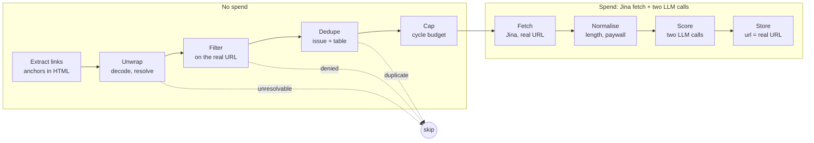

# Spec — Newsletter Content Extraction & Link Following

**Status:** Draft · 24 Oct 2026 · Chris

## Overview

Newsletter content lands in `news_items` carrying the email's plumbing, and followed links are stored under subscriber-identifying tracking URLs. This spec fixes both at ingest, adds a safe reader for third-party content, and cleans the rows already stored.

- **Feature:** Research newsletter ingestion — email body extraction and link following
- **Apps touched:** `apps/agents` (ingest), `apps/web` (`/news/[id]` reader), `packages/ui` (renderer), `supabase/migrations` (raw HTML retention, source config)
- **Status:** Draft, from a review of `main` at `f2efd36` and the live `news_items` table on 24 Oct 2026
- **Why now:** Rex scores what it can read in the first 12,000 characters, and the planned Minute Media section would expose these URLs and bodies to subscribers

## Problem and evidence

Roughly 41% of a stored email body is URL characters, and 99% of followed-link items are stored under a tracking wrapper. All figures below come from `news_items` on 24 Oct 2026.

### Email bodies

Measured across 861 email items, excluding Seeking Alpha, whose bodies mostly arrive through the link path.

| Symptom | Cause | Scale |
| --- | --- | --- |
| Wall of invisible characters at the top | Preheader spacer (U+034F, U+00AD, zero-width) inside `display:none` elements; Turndown ignores inline styles | Most HubSpot, Ghost and Glassnode items; 1.6% of all body characters |
| Tracking redirect URLs | HubSpot, Customer.io and Ghost wrap every link; a single HubSpot link runs to about 1 KB | 41% of body characters are inside link parentheses |
| Empty links `[](…)` | Images are removed but their wrapping anchors survive | 987 of 1,788 Seeking Alpha items; nearly every Glassnode and Willy Woo item |
| Template chrome | View in browser, Unsubscribe, postal address, share and refer blocks. Step 1 of `extract_content` in `news-source-email-spec.md` required stripping these; the code strips only `img`, `style`, `script`, `noscript` | Present in almost every non–Seeking Alpha item |
| Repeated lines | Subject repeated as the first line; TFTC prints "View in browser" twice | Common |
| Collapsed layout | Presentation tables flattened, no GFM plugin, Turndown escaping (`\-`, `\.`) | 216 items show table pipes; 297 show escaped characters |

### Followed links

1,248 items carry `rex_metadata.from_newsletter_item_id`.

| Finding | Detail | Scale |
| --- | --- | --- |
| Tracking wrappers never unwrapped | `fetchUrl` returns Jina's `data.url`, which in practice is the input URL. The code comment assumes otherwise | 1,230 of 1,248 (99%) store the wrapper as `url` |
| Deny lists check the wrapper, not the destination | X posts arrive through `substack.com/redirect`; TFTC links to its own issues; a Seeking Alpha subscriptions page and a conference ticket page were followed | Unknown share; every filter except anchor text is blind |
| Dedup broken | Wrappers are unique per send, so `ingestion_ref` and `url` uniqueness never fire across issues | 115 duplicate rows across 52 titles |
| Subscriber tokens in stored URLs | Ghost `m=`, Substack `j=` token, Seeking Alpha click IDs identify BTS's paid accounts. Clicking "View original" registers as BTS | At least 205 rows match a token parameter; all Seeking Alpha click URLs are per-recipient |
| Low yield | Seeking Alpha is 1,031 of 1,248 followed items, average score 0.10, 21 at or above 0.5. Each cost a Jina fetch plus two LLM calls | 52 of 1,248 (4%) score 0.5 or higher overall |
| Jina body clutter | `![Image n: …]` lines kept, cookie and sign-in text, truncation at the 50,000-character cap | 1,150 bodies keep image lines; 63 hit the cap |
| Live failure | Every followed link on 22 and 23 Oct landed `status = 'extraction_failed'` with no score | 26 of 26 rows |

### Cost to the agents

`extractNewsMetadata` and Rex's rubric (`newsRubric.ts`) each read `body.slice(0, 12000)`. On a Fear & Greed issue the first few kilobytes are spacer and one HubSpot URL, so both calls run on a partial read. The `fts` column indexes the same tokens.

## Goals and non-goals

The target is a body a human reads as the article and an LLM reads without wasting its 12,000-character window.

### Goals

1. Stored bodies contain the issue's content and nothing else: no preheader, chrome, empty links or tracking parameters.
2. Every followed-link item is stored under the article's real URL, with no subscriber-identifying token anywhere in `news_items`.
3. Deny lists and dedup run on the real destination, before any Jina fetch or LLM call.
4. Link following is gated per source, so low-yield sources stop costing calls.
5. Raw HTML is retained, so extraction can be re-run as the cleaner improves.
6. `/news/[id]` renders links, tables and headings correctly and safely, server-side.
7. Existing rows are cleaned, deduplicated and re-scored where the body changed materially.

### Non-goals

- An LLM "extract the main content" step. Extraction stays deterministic, per the module comments and the Workflow-vs-Agent rule in `CLAUDE.md`.
- Images in the reading view. The ingestion spec's no-images rule stands.
- Changing the Rex rubric, its thresholds or the 12,000-character window.
- The Minute Media section itself. This spec only makes the data safe for it.
- CRM email (`fastmailListener` → `interactions`). Same `stripHtml` weaknesses, separate path; see Open questions.

## Current pipeline

One listener feeds two paths, the issue body and the links inside it, and both converge on `ingestNewsItem`. Paths are under `apps/agents/src` unless noted.

| Module | Role today | What goes wrong |
| --- | --- | --- |
| `listeners/researchMailListener.ts` | Polls each account's research folder every 5 min; validates sender and SPF/DKIM; calls `htmlToMarkdown`, `extractNewsMetadata`, `ingestNewsItem`; then `ingestNewsletterLinks` when `follow_links` is on | Discards the raw HTML after conversion; runs `extractNewsMetadata` on links before any dedup |
| `lib/newsletterExtract.ts` | `htmlToMarkdown` (Turndown, removes `img`/`style`/`script`/`noscript`), `extractCanonicalUrl`, `synthesizeEmailUrl`, `senderAllowed` | No hidden-element, chrome, empty-link or invisible-character handling; no GFM tables |
| `lib/newsletterLinks.ts` | `extractNewsletterLinks`: regex over anchors, host/path/anchor deny lists, dedup by host+path, strips `utm_*` and a few params | All filters and dedup run on the wrapper URL |
| `agents/researcher/tools.ts` → `fetchUrl` | Jina Reader (`r.jina.ai`), unauthenticated, JSON mode, 50,000-character cap, returns `resolved_url` | `resolved_url` is the wrapper in practice; images and site chrome kept |
| `lib/fetchOgImage.ts`, `lib/paywalledDomains.ts` | Page meta, OG image, paywall stub detection | Run against the wrapper URL |
| `workflows/ingestNewsItem.ts` | `ingestion_ref` dedup → embed (title + summary) → Rex rubric (`body.slice(0, 12000)`) → persist `body_markdown` | `ingestion_ref` for links is `{parentRef}#link:{wrapperUrl}`, unique per send |
| `lib/fastmailJmap.ts` → `extractBody` / `stripHtml` | Plain-text fallback when an email has no HTML part | Regex strip; same weaknesses as above |
| `apps/web/components/company/MarkdownRecordDisplay.tsx` | Read-only Tiptap v2 editor, `StarterKit` + `tiptap-markdown`, `html: false`, `immediatelyRender: false` | v2 StarterKit has no Link or Table extension; blank until hydration |

## Design: email body extraction

Clean the DOM before Turndown, convert with GFM, then normalise the markdown. All three stages are pure functions in `apps/agents/src/lib/`, tested against golden fixtures.

```ts
// lib/emailClean.ts — cheerio, already a dependency of apps/agents
export function cleanEmailHtml(html: string): { html: string; removed: CleanReport };

// lib/newsletterExtract.ts — htmlToMarkdown keeps its signature
export function htmlToMarkdown(html: string, opts?: { subject?: string }): string;
//   = normaliseMarkdown(turndownGfm(cleanEmailHtml(html).html), opts)

// lib/urlClean.ts — shared with newsletterLinks.ts
export function unwrapOffline(url: string): string | null;
export function stripTrackingParams(url: string): string;

// packages/shared/src/newsUrl.ts — wrapper hosts + token params, shared with packages/ui
export function isSubscriberScoped(url: string): boolean;
```

### Stage 1 — DOM clean (`cleanEmailHtml`)

Applied in this order. Each rule increments a counter in `CleanReport`, logged once per email so rules can be tuned from real mail.

1. **Hidden elements.** Remove any element whose inline style sets `display:none`, `visibility:hidden`, `max-height:0`, `opacity:0`, `font-size:0` or `mso-hide:all`, and any element with class `preheader` or `preview-text`.
2. **Image-only anchors.** Remove an `<a>` whose text is empty after removing `img` and whitespace.
3. **Chrome anchors.** Remove anchors whose text matches `DENY_ANCHOR_RE` (moved from `newsletterLinks.ts` to `urlClean.ts` and shared). "View in browser" is removed here; `extractCanonicalUrl` runs on the raw HTML first, so nothing is lost.
4. **Footer block.** Find the last element whose text or href mentions unsubscribe or manage preferences. Remove its smallest block ancestor (`td`, `table`, `div`, `p`) whose text is under 600 characters, plus that ancestor's following siblings. Guard: skip when the removal would take more than 25% of the body's text.
5. **Layout tables.** Unwrap `table`, `tbody`, `tr`, `td` when the table has `role="presentation"`, a `width`/`align`/`bgcolor` attribute, or any cell containing a block element. Unwrapped cells become `div`s, so their content keeps its order. Remaining tables are data tables and go to GFM.
6. **Links.** For every surviving `href`: `unwrapOffline`, then `stripTrackingParams`. If the result is still subscriber-scoped, replace the anchor with its text.
7. **Empty containers.** Remove elements left with no text.

### Stage 2 — convert (`turndownGfm`)

Turndown with `turndown-plugin-gfm` for tables and strikethrough, same `headingStyle: 'atx'`. Keep the `img`/`style`/`script`/`noscript` removal and the `MAX_HTML_CHARS = 500_000` cap; the agents host is memory-constrained. The tag-strip fallback stays for Turndown failures.

### Stage 3 — normalise (`normaliseMarkdown`)

Runs on every body before it reaches `ingestNewsItem`, including the plain-text fallback and Jina output.

1. Remove U+034F, U+00AD, U+200B–U+200D, U+2060, U+FEFF and U+2007; turn U+00A0 into a space.
2. Remove `[](…)` and image markdown that slipped through.
3. Undo escaping that changes nothing in rendering (`\-` mid-line, `\.` after non-digits).
4. Drop the first non-empty line when it equals the subject, ignoring case and punctuation.
5. Collapse consecutive identical lines, then blank-line runs.
6. Trim.

### Link rules in bodies

| Wrapper type | Example hosts | Handling |
| --- | --- | --- |
| Destination encoded in the URL | `email-st.seekingalpha.com/click/…/<base64>`, Glassnode/Customer.io `/e/c/<base64 JSON>` | Decode offline to the real URL |
| Opaque redirect | HubSpot `hubspotlinks.com`, Ghost `/r/<id>?m=`, `substack.com/redirect`, Beehiiv, Mailchimp `/track/click` | Text only in the body; the URL never reaches storage |
| Plain URL with tracking params | Most others | Strip `utm_*`, `_hsenc`, `_hsmi`, `mc_cid`, `mc_eid`, `ck_subscriber_id`, `fbclid`, `gclid`, `mkt_tok`, `igshid` |

`canonical_url` goes through the same steps. If it is opaque, resolve it with one `redirect: 'manual'` request (Design: link following, step 3), since it is a single request per issue.

## Design: link following

Resolve every candidate to its real URL first, then filter and dedupe on that URL, and only then spend a Jina fetch or an LLM call. A link that cannot be resolved is skipped, never stored.



The free steps cost nothing. A link reaches the spend stage only once it is resolved, allowed, new and within the cycle's budget.

### Order of operations in `ingestNewsletterLinks`

1. **Extract candidates** from the raw HTML with `extractNewsletterLinks`, as today, but with no cap yet. The cap applies after filtering, so chrome no longer eats the budget.
2. **Unwrap offline** with `unwrapOffline`: Seeking Alpha click paths and Customer.io `/e/c/` payloads decode without a request.
3. **Resolve opaque wrappers** with a new `resolveRedirect(url)` in `lib/urlClean.ts`. It issues `GET` with `redirect: 'manual'`, reads `Location`, and repeats while the next host is a known wrapper host, up to 3 hops and a 5-second total timeout. It never reads a body. `GET`, not `HEAD`, because many wrappers reject `HEAD` (noted in the current module comment). Only candidates that survive anchor-text filtering get this request.
4. **Strip tracking parameters** and compute `dedupKey` on the real URL.
5. **Filter on the real URL**: host deny list, path deny list, asset extensions, the newsletter's own domain (the sender domain and the `canonical_url` host), and the source's own allow and deny patterns (Data model changes).
6. **Dedupe** against the in-issue set, then against `news_items.url` for the real URL, before any spend.
7. **Cap**: take the first `min(max_followed_links, budget.remaining)` survivors in document order. Decrement the budget here.
8. **Fetch** the real URL, never the wrapper, through `fetchUrl` with the new headers below.
9. **Normalise** the body with `normaliseMarkdown`, then apply the existing minimum-length and paywall-stub checks.
10. **Extract and ingest**: `extractNewsMetadata`, then `ingestNewsItem` with `url` = real URL and `ingestionRef` = `{parentRef}#link:{realUrl}`.

A final assertion before `ingestNewsItem`: `isSubscriberScoped(url)` must be false. If it is true, log `{ host }` (never the full URL) and skip.

### `fetchUrl` changes

| Change | Why |
| --- | --- |
| Send `X-Retain-Images: none` | Removes the `![Image n: …]` lines Jina adds |
| Send `Authorization: Bearer ${JINA_API_KEY}` when the variable is set | Higher rate limit; the listener is sequential today to stay under the unauthenticated limit |
| Pass `X-Target-Selector` from the source's `link_extract_config` when present | Article-element extraction for sites with heavy chrome |
| Return `truncated: true` when content hits the 50,000-character cap | Lets ingest flag the row instead of storing a silently cut article |
| Keep `resolved_url`, but treat it as a hint | Jina's `data.url` echoed the input for 99% of wrapped links |

`fetchUrl` is also a Researcher tool, so the new headers must not change the tool's output shape for the agent; `truncated` is additive.

### Per-source gating

Two new pattern columns on `news_sources` (Data model changes) let a source follow only links that match. The proposed defaults:

| Source | Proposal | Basis |
| --- | --- | --- |
| Seeking Alpha | `follow_links = false`, or allow only `seekingalpha.com/article/` | 1,031 items, average score 0.10, 21 at or above 0.5 |
| TFTC | Keep on; the self-domain rule removes links back to its own issues | 135 items, average 0.27 |
| Anthony Pompliano | Keep on; real-URL filtering removes X posts and event pages | 60 items, average 0.12 |
| Hashrate | Keep on | 17 items, average 0.26 |

### The 22–23 Oct failures

Every followed link on those two days stored `status = 'extraction_failed'`, meaning `extractNewsMetadata` returned no data under scope `newsletterLinks.extract`. Diagnose this first, from Railway logs and the `model_configs` row for that scope, before any other session; it is likely unrelated to this spec and is costing rubric scores now.

## Data model changes

One new table holds raw email HTML, team-only; `news_sources` gains three link-following columns; `news_items` gains one flag. One migration, timestamped after `20261018100000_library_papers.sql`.

### `news_item_raw` (new)

Raw HTML lives in its own table, not on `news_items`. It contains subscriber tokens by nature, so it must never reach a client read model or a Minute subscriber session.

| Column | Type | Notes |
| --- | --- | --- |
| `news_item_id` | `UUID` PK | FK → `news_items(id)` `ON DELETE CASCADE` |
| `format` | `TEXT` | `html` or `text` |
| `raw` | `TEXT` | The body as fetched, capped at 1 MB (matches `maxBodyValueBytes`) |
| `raw_chars` | `INT` | Length before the cap, so truncation is visible |
| `extractor_version` | `TEXT` | Version of the cleaner that produced the current `body_markdown`, e.g. `email-2026.11.1` |
| `created_at` | `TIMESTAMPTZ` | |

Email items only. Followed-link items are refetchable by URL, so they store nothing here.

### `news_sources` (three columns)

| Column | Type | Default | Notes |
| --- | --- | --- | --- |
| `link_allow_patterns` | `TEXT[]` | `'{}'` | Host or host-plus-path prefixes, e.g. `seekingalpha.com/article/`. Empty means no allow filter |
| `link_deny_patterns` | `TEXT[]` | `'{}'` | Same syntax; checked after the global deny lists |
| `link_extract_config` | `JSONB` | `'{}'` | Per-source Jina options. Shape: `{ "targetSelector"?: string, "removeSelector"?: string }` |

### `news_items` (one column)

| Column | Type | Default | Notes |
| --- | --- | --- | --- |
| `body_truncated` | `BOOLEAN` | `false` | Set when the HTML or Jina cap cut the body |

### Migration

```sql
-- supabase/migrations/2026MMDD000000_newsletter_extraction.sql

CREATE TABLE news_item_raw (
  news_item_id      UUID PRIMARY KEY REFERENCES news_items(id) ON DELETE CASCADE,
  format            TEXT NOT NULL CHECK (format IN ('html', 'text')),
  raw               TEXT NOT NULL,
  raw_chars         INT  NOT NULL,
  extractor_version TEXT NOT NULL,
  created_at        TIMESTAMPTZ NOT NULL DEFAULT NOW()
);

ALTER TABLE news_item_raw ENABLE ROW LEVEL SECURITY;

-- Team only. Raw newsletter HTML carries subscriber tokens; no subscriber
-- policy, ever. Uses the predicate from 20260910000000_rls_hardening.sql.
CREATE POLICY news_item_raw_team ON news_item_raw
  FOR ALL USING (is_team_member()) WITH CHECK (is_team_member());

ALTER TABLE news_sources
  ADD COLUMN IF NOT EXISTS link_allow_patterns TEXT[] NOT NULL DEFAULT '{}',
  ADD COLUMN IF NOT EXISTS link_deny_patterns  TEXT[] NOT NULL DEFAULT '{}',
  ADD COLUMN IF NOT EXISTS link_extract_config JSONB  NOT NULL DEFAULT '{}';

ALTER TABLE news_items
  ADD COLUMN IF NOT EXISTS body_truncated BOOLEAN NOT NULL DEFAULT false;
```

The agents server writes with the service role, so the policy only governs the web apps. Confirm `audit_permissive_policies()` still returns zero rows after the migration, then regenerate types with `pnpm --filter @platform/db generate-types` and record the change in `docs/schema-changes.md`.

## Rendering

Replace the read-only Tiptap editor on `/news/[id]` with a server-rendered markdown component in `packages/ui`, built for third-party text. Minute's Media section will reuse it.

### `ArticleMarkdown` (new, `packages/ui`)

- `react-markdown` + `remark-gfm`, with `skipHtml` on. Raw HTML in a body renders as text, never as markup.
- `urlTransform` allows only `http:`, `https:` and `mailto:`. Anything else drops the `href` and keeps the text.
- Defence in depth: an `href` for which `isSubscriberScoped` is true renders as text. The wrapper-host and token-parameter lists live in `packages/shared/src/newsUrl.ts`, so `apps/agents`, `packages/ui` and `apps/client` share one definition.
- External links get `target="_blank" rel="noopener noreferrer nofollow"`.
- Tables sit in a container that scrolls on its own, so the page never scrolls sideways at 375 px or 320 px. Long URLs and tokens wrap with `overflow-wrap: anywhere`.
- Typography, spacing and colour from `packages/ui/src/tokens.css` via the `bts-design` skill: body in DM Sans at reading measure, headings stepped down one level so an article's `h1` never competes with the page title.
- No client JavaScript. The component renders in a server component.

The client app's `components/Markdown.tsx` is not a substitute. Its header limits it to BTS-authored, Lex-reviewed text, and it supports no tables.

### Wiring

`NewsItemDetail.tsx` is a client component today. Render `<ArticleMarkdown>` in the server `page.tsx` and pass it to `NewsItemDetail` as a `body` prop, or move the body out of the client boundary. `MarkdownRecordDisplay` stays for its other two consumers, `CompanyHero` and `NewsletterRunStatus`.

## Backfill and cleanup

One script, `apps/agents/scripts/backfillNewsletterContent.ts`, dry-run by default, writes a CSV report of every intended change before anything is written. Run it only after the new extractors ship and pass their fixtures.

### Steps

1. **Snapshot.** Copy `id`, `url`, `canonical_url`, `body_markdown`, `relevance_score` and `status` of every affected row to `news_items_backfill_snapshot`, RLS team-only. Drop it once the result is verified; it holds the same tokens being removed.
2. **Email items, raw available.** For each email item, look up the message in the account's research folder by Message-ID (`ingestion_ref`). If found, store it in `news_item_raw` and regenerate `body_markdown` and `canonical_url` with the new extractor.
3. **Email items, raw gone.** Apply `normaliseMarkdown` plus a markdown-level link pass: decode encodable wrappers, reduce opaque-wrapper links to their text, and strip tracking parameters. Leave the footer alone; there is no DOM to guard the cut.
4. **Followed-link URLs.** Decode Seeking Alpha click URLs offline. Resolve the remaining wrappers (Ghost, Substack and others, about 200 rows) with `resolveRedirect`, throttled to 1 request a second. Rows that still fail resolution go on the report for a decision (Open questions).
5. **Re-filter.** Apply the real-URL deny rules and the new per-source settings to the resolved URLs. Rows that would now be filtered (X posts, self-links, subscription and ticket pages) go on the report as deletion candidates.
6. **Collapse duplicates.** Where two rows now share a URL, keep the one with the higher `relevance_score`, then the earlier `created_at`. Append any `curator_notes` from the other row, repoint `reports.news_item_id` (the only foreign key to `news_items`), and update any `rex_metadata.from_newsletter_item_id` that named the removed row.
7. **Re-score selectively.** Re-run `extractNewsMetadata` and the rubric only where the first 12,000 characters of the body changed materially, defined as more than 20% of those characters. Everything else keeps its score. Estimate the count in the dry run before committing spend.
8. **Verify** with the acceptance queries (Testing and verification), then drop the snapshot.

Deletions run only from an approved report: the script takes the reviewed CSV as input for its write pass, so nothing is removed that a person has not seen.

## Testing and verification

Done means the acceptance queries below hit their targets on fresh ingests and on backfilled rows, and every suite named in `CLAUDE.md` is green.

### Golden fixtures

One HTML email per template family under `apps/agents/test/fixtures/newsletters/`, each with an expected `.md` snapshot: HubSpot (Fear & Greed), Ghost (TFTC), Customer.io (Glassnode), Substack (Pompliano), Seeking Alpha, and one plain-text-only email.

`business-mono` is a public repository. Fixtures keep each template's structure but replace every token, subscriber ID and redirect payload with placeholders, and replace paid article text with filler. Never commit a raw email.

### Unit tests (next to each module)

| Module | Cases |
| --- | --- |
| `lib/urlClean.ts` | Seeking Alpha base64 decode; Customer.io JSON decode; malformed payloads return `null`; tracking-parameter strip keeps meaningful params |
| `packages/shared/src/newsUrl.ts` | `isSubscriberScoped` true for every wrapper host and token parameter, false for clean article URLs |
| `resolveRedirect` | Mocked `fetch`: follows wrapper hops, stops at the first non-wrapper host, stops at 3 hops, honours the timeout, never reads a body |
| `lib/emailClean.ts` | One case per rule; footer guard refuses a cut over 25% of text |
| `normaliseMarkdown` | Invisible characters, empty links, subject-line dedupe, repeated lines |
| `ingestNewsletterLinks` | No `fetchUrl` call for a denied, duplicate or unresolvable link; budget decremented only after filtering; stored `url` and `ingestionRef` use the real URL |
| `ArticleMarkdown` | Raw HTML renders as text; non-http `href` and subscriber-scoped `href` render as text; tables get the scroll wrapper |

Per the `CLAUDE.md` lesson on vacuous passes: disable each `emailClean` rule in turn and confirm at least one fixture fails.

### Acceptance queries

| Metric | 24 Oct 2026 | Target |
| --- | --- | --- |
| Share of email-body characters inside link parentheses | 40.8% | under 10% |
| Share of invisible characters in email bodies | 1.6% | 0 |
| Email bodies with `[](` | most sources | 0 |
| Followed items stored under a wrapper URL | 1,230 of 1,248 | 0 |
| Rows with a subscriber-scoped `url` or `canonical_url` | 205 or more | 0 |
| Extra duplicate rows among followed items | 115 | 0 |
| New followed items with `![Image` lines | 1,150 of 1,248 | 0 |

```sql
-- Re-run after each session and after the backfill
with e as (
  select ni.body_markdown b
  from news_items ni join news_sources ns on ns.id = ni.source_id
  where ns.source_type = 'email' and ni.body_markdown is not null
    and ni.created_at > :since
)
select
  round(100.0 * sum(length(b) - length(regexp_replace(b, '\]\([^)]*\)', '](x)', 'g'))) / sum(length(b)), 1) as pct_url,
  sum((b ~ '[͏­​‌‍]')::int) as invisible_rows,
  sum((b ~ '\[\s*\]\(')::int)                               as empty_link_rows
from e;
```

### Commands

- `pnpm --filter @platform/agents test` and `pnpm --filter @platform/agents typecheck`
- `pnpm --filter @platform/ui test` and `pnpm --filter @platform/web test`
- `pnpm --filter @platform/db test` (migration and view checks)
- `/news/[id]` checked at 375 px and 320 px: no page-level horizontal scroll, tap targets at least 44 px

## Build sequence

Seven sessions, numbered from 0. The link path goes before the email body because it carries the token exposure and most of the wasted spend.

0. **Diagnose the 22–23 Oct extraction failures.** Railway logs and the `newsletterLinks.extract` row in `model_configs`. Verify: the next followed link stores `status = 'new'` with a score.
1. **Shared URL layer.** `packages/shared/src/newsUrl.ts` (wrapper hosts, token parameters, `isSubscriberScoped`) and `apps/agents/src/lib/urlClean.ts` (`unwrapOffline`, `stripTrackingParams`, `resolveRedirect`), with tests. Verify: agents and shared suites green.
2. **Link following.** Reorder `ingestNewsletterLinks`, move `extractNewsletterLinks` onto real URLs, add the `fetchUrl` headers and `truncated` flag, apply the migration, and expose the three new `news_sources` fields in `apps/web/app/(app)/news/sources/NewsSourceForm.tsx`. Set Seeking Alpha per Open questions. Verify: after one day of mail, the wrapper, token and duplicate queries return 0 for new rows.
3. **Email body extraction.** `emailClean.ts`, GFM conversion, `normaliseMarkdown`, the anonymised fixtures, and `news_item_raw` writes from `researchMailListener`. Verify: fixture snapshots and the rule-disabling check pass; acceptance queries on fresh ingests meet target.
4. **Renderer.** `ArticleMarkdown` in `packages/ui`, wired into `/news/[id]`. Verify: ui and web suites green; 375 px and 320 px checks pass.
5. **Backfill.** Dry run, review the CSV, then the write pass. Verify: every acceptance query meets target across all rows; snapshot dropped.
6. **Docs.** Update `apps/agents/README.md`, step 1 of `extract_content` in `docs/news-source-email-spec.md`, `docs/schema-changes.md`, and add a `CLAUDE.md` "When working on" row pointing at `newsUrl.ts`. Run `node scripts/check-doc-links.mjs`.

## Open questions

- [ ] **Seeking Alpha link following:** turn it off, or allow only `seekingalpha.com/article/`? The proposal is off; 21 of 1,031 followed items scored 0.5 or higher.
- [ ] **Opaque links inside email bodies:** keep text only (proposed), or resolve each with `resolveRedirect`? Resolving keeps the links but costs dozens of requests per issue, and each one registers as a click with the sender.
- [ ] **Unresolvable followed-link rows in the backfill:** delete them (proposed, after review), or keep them with `url` replaced by a synthetic `email://` form so they stay readable in-app?
- [ ] **Jina API key:** add `JINA_API_KEY` to the agents service? It raises the rate limit and would allow some concurrency in link following.
- [ ] **CRM email path:** `extractBody` and `stripHtml` feed `interactions.raw_content` with the same problems. Apply `cleanEmailHtml` and `normaliseMarkdown` there in a follow-up, or fold it into session 3?
- [ ] **Raw HTML retention period:** keep `news_item_raw` indefinitely, or prune after 12 months once bodies are stable?
